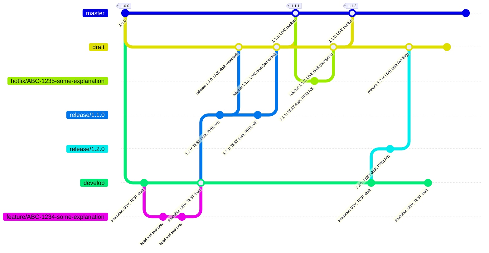

# jenkinsfile-starter

A Jenkinsfile template, example, and probe project for running pipelines in Jenkins.

The repository contains a Jenkinsfile that is an example and a reusable CI pipeline **template** for projects
written in any programming language.

The template contains placeholders that can be replaced and filled with all project-specific needs, requirements, tools.

Changes with minimal changes to get it running in Jenkins fast – do as minimal changes as possible to get it done and
running.

## Goals

To get faster feedback, why is failing, in order:

* code doesn't compile
* test code doesn't compile
* unit tests are failing
* integration tests are failing
* mutation tests are failing
* quality measurements are failing
* e2e tests are failing
* acceptance tests are failing

## Requirements

Master should go to the live publish stage, draft to the live draft stage. No any other branch should go to live.
Mostly conditional switch should be switched on.

Release branch can go test, prelive by conditional switches.

Development branch is optional. Mostly Jenkinsfile is planned for trunk based development scenarios.

Hotfix branch (`hotfix*`, branched from master) is supported since 1.1.0: it runs the full build/test path like every
branch, publishes a hotfix candidate, and can deploy to test and prelive by conditional switches
(`HOTFIX_TO_TEST_DRAFT`, `HOTFIX_TO_PRELIVE`; `HOTFIX_TO_DEV` off by default). It never goes live itself - after quick
review and test it is merged to draft and draft to master, and the master build deploys live and tags.

Draft branch (`draft`) is supported since 1.3.0. Mostly for web, PWA, FE, and CMS projects. Flow is
`release* -> draft -> master`, and releasing to LIVE goes in two stages:

* live draft stage (`DRAFT_TO_LIVE`) - LIVE, but seen only by reviewers. The draft build is the release: it builds,
  publishes the release package to package storage (Nexus, SCP, Samba, NFS, ... file server) and deploys it to the
  live draft stage.
* live publish stage (`MASTER_TO_LIVE`) - what everyone sees. Users accept the draft by merging `draft` to `master`
  (fast-forward). The master build still builds and tests, but publishes nothing: the release is already published.
  It promotes the same package from the live draft stage to the live publish stage and tags.

Releases are immutable: a published release version is never built or published again, what goes live is the package
that was reviewed. A rejected draft is fixed with a new version. How the package moves from the live draft stage to the
live publish stage is up to the project. Every change, hotfixes included, goes through `draft` before `master`. The
live draft stage holds one change: while it waits for acceptance, the next one waits behind it or is accepted together
with it.

TEST is set up as much as possible like LIVE, so that every aspect of LIVE can be tested there. It has the same two
stages, test draft stage and test publish stage. Every TEST deployment (`develop`, `release*`, `hotfix*`) goes to the
test draft stage, gated by the `*_TO_TEST_DRAFT` switches. The test publish stage is reserved: its
`*_TO_TEST_PUBLISH` switches are commented out in the environment block, so the pipeline skips it and the draft is
published there manually or with other tools. Uncommenting a switch turns the test publish stage on for that branch.

Software without drafting has no `draft` branch: the flow is `release* -> master`, and master releases and publishes,
as in 1.2.0. The build shifts back to master - Release and Release reports run on `master` instead of `draft`,
`DRAFT_TO_LIVE` is not used, and master publishes the release and deploys it to the live publish stage. In the tables
below the `draft` row then moves to `master`, and hotfixes are merged to master directly.

### Branching model

Commit labels show what the build of that commit publishes and where it deploys, with the default switches. A
rejected draft is fixed in the release branch with a new version and merged to `draft` again. A hotfix goes through
`draft` like a release; when QA asks for more testing, it is merged to `develop` instead.



Without drafting, the `draft` lane is missing: `release*` and `hotfix*` are merged to `master`, and the master build
publishes the release and deploys it to the LIVE publish stage.

### Publishing by branch

| Branch     | Release | Snapshot | Release reports | Snapshot reports |
|------------|:-------:|:--------:|:---------------:|:----------------:|
| `feature*` |    –    |    –     |        –        |        –         |
| `develop`  |    –    |    ✓    |        –        |        ✓        |
| `release*` |    –    |    –     |        –        |        –         |
| `hotfix*`  |    –    |    –     |        –        |        –         |
| `draft`    |   ✓    |    –     |       ✓        |        –         |
| `master`   |    -    |    –     |        -        |        –         |

In software built without drafting, the `draft` branch is missing and `master` takes over the publishing that
`draft` does.

### Deployment by branch and environment

| Branch     | DEV | TEST draft stage | TEST publish stage | PRELIVE | LIVE draft stage | LIVE publish stage |
|------------|:---:|:----------------:|:------------------:|:-------:|:----------------:|:------------------:|
| `feature*` |  –  |        –         |         –          |    –    |        –         |         –          |
| `develop`  | ✓  |        ✓        |         –          |    –    |        –         |         –          |
| `release*` |  –  |        ✓        |         –          |   ✓    |        –         |         –          |
| `hotfix*`  |  –  |        ✓        |         –          |   ✓    |        –         |         –          |
| `draft`    |  –  |        –         |         –          |    –    |        ✓        |         –          |
| `master`   |  –  |        –         |         –          |    –    |        –         |         ✓         |

In software built without drafting, the `draft` branch is missing and `master` deploys directly to the LIVE publish
stage. There is no LIVE draft stage. In TEST draft will be published manually or with other tools.
In Git repositories of software without drafting, the TEST and LIVE draft stage columns are merged into their publish
stage columns with OR: a branch deploys to the publish stage if either of the two columns has ✓.

### Jenkins plugins

Usually Jenkins preferred/default plugins setup.

1. Email Extension Plugin
2. Mailer Plugin

### Jenkins configuration

1. System Admin e-mail address
2. Extended E-mail Notification settings
3. E-mail Notification settings
4. Jenkins URL

### Notifications

The pipeline mails the result to one hard coded address, `SMI_MAIL_TO` in the `environment` block, on success,
on unstable and on failure, the failure with the console log attached and compressed. It is a fixed `to:` and
not `DevelopersRecipientProvider`, so a build reports even when the committer has no address in Jenkins or the
push came from CI itself. Replace `example@example.com` with the address of the project.

``` groovy
environment {
    SMI_MAIL_TO = 'example@example.com'
}
```

Mail needs the Email Extension Plugin and an SMTP server under *Manage Jenkins -> System -> Extended E-mail
Notification*. Without the server, the mail step is the only red thing in an otherwise green build.

### Tips and tricks

1. Environment variables and other variables usage

Note that " and ' have difference

``` groovy
ABC = 'DEF'
GHI = "$ABC"
```
